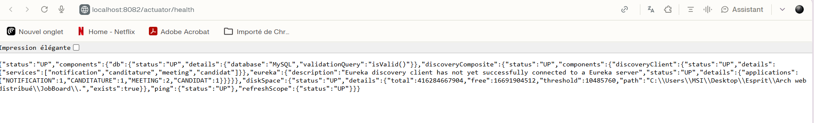
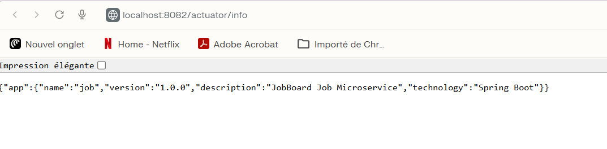
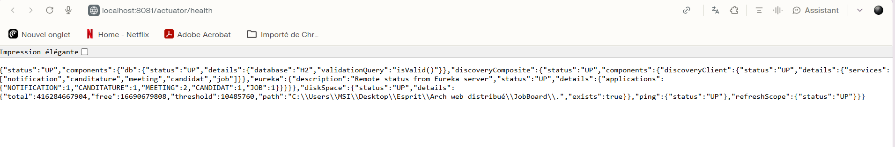
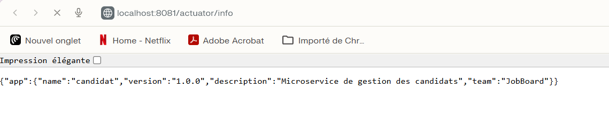
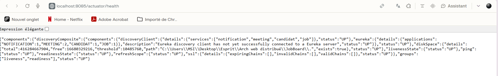
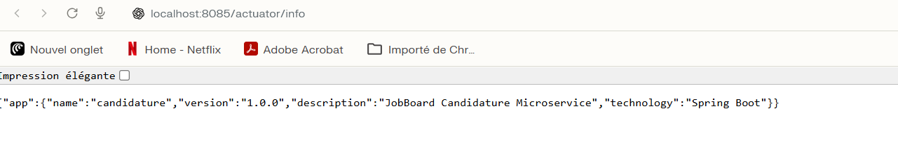
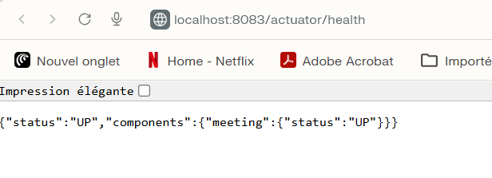
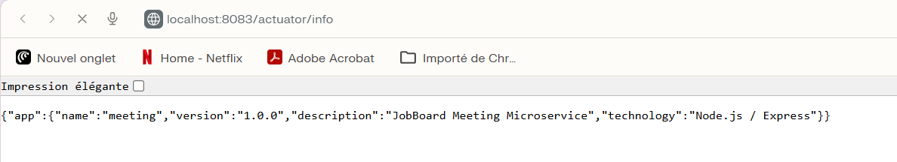
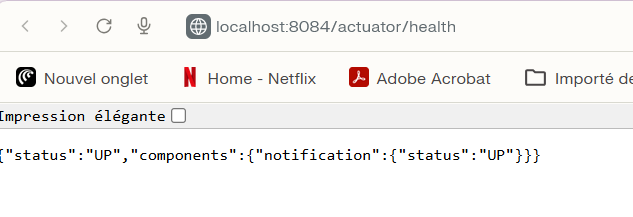
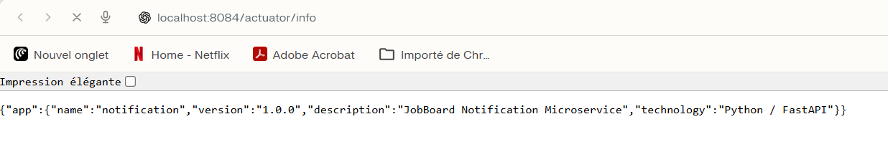

# JobBoard Microservices Monitoring & Service Discovery

## Team Members
- **Fida Sassi**
- **Chayma Ayari**
- **Nour ELhouda Htira**
- **Chedi Khemiri**

---

## Eureka Dashboard

La capture suivante montre les microservices enregistrés dans **Eureka Server**,  
y compris **deux instances du microservice MEETING** exécutées sur des ports différents.

  

---

## Actuator - JOB Microservice

### Health Endpoint

  

### Info Endpoint

  

---

## Actuator - CANDIDAT Microservice

### Health Endpoint

  

### Info Endpoint

  

---

## Actuator - CANDIDATURE Microservice

### Health Endpoint

  

### Info Endpoint

  

---

## Actuator - meeting Microservice

### Health Endpoint

  

### Info Endpoint

  

---

## Actuator - notif Microservice

### Health Endpoint

  

### Info Endpoint

  

